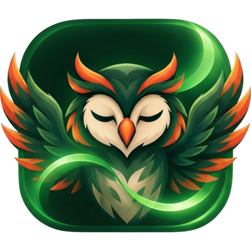

<h1 align="center">
  <br>
  Claude Chyron
</h1>

> **chy·ron** · US /ˈkaɪrɑn/, UK /ˈkaɪrɒn/ (*KY-ron*) · *noun*, plural *chyrons*
>
> A line of text laid over the lower part of a video picture, such as the headline or the ticker that runs under a news broadcast.
>
> *After the Chyron Corporation, whose 1970s character generator drew such captions.*

A chyron says what is happening without stopping the broadcast. Claude Chyron does the same for Claude Code: a mod (plugin name `chyron`) that sits between the Focus view and the standard view, showing the latest running tool, background task or subagent call without opening the full transcript.

**Token-free.** It makes no model calls and passes every prompt, tool call and response through unchanged, so it adds nothing to the context and costs none of your usage. Even its token counts are read from the usage the engine already reports.

- **Status line** while something runs or has just run, one entry for every running call and background task, latest start first: `🦉 Bash 12s · <description or command> ⏳ Agent 340s · <description>`. The last finished call stays as `✓ … done 4s ago` through the turn, so a chain of quick calls does not flash and vanish.
- **One frame a second.** The line is redrawn once a second, every entry and every time in it together, and nothing changes it in between. The first entry after an idle spell draws at once and starts the seconds. At each tick, each position of the list shows the entry that held it for most of the second just gone (the newest when two held it equally long). An entry that held a position for less time than the position stood empty is left out, so a call that starts and ends within the second does not flash by. All the times (`12s`, `done 4s ago`) count to the tick, so they move together. When the work ends the line clears at the next tick, up to a second later. The one thing that does not wait for the tick is whether the terminal's status line may show it: it hides when a turn starts and returns when it ends, so the list is never drawn twice.
- **The owl.** On the terminal a `🦉`, the owl of the logo, starts every entry, as a channel's on-screen logo marks its broadcast. It takes the place of the `▶` that marks a running entry, of the `│` between entries and of the `▸` before an agent's latest tool, so several running entries show several owls (`🦉 Bash 12s · build 🦉 Bash 12s · test`); a finished entry keeps its `✓` after the owl. After the engine's own word or the compaction text the owl follows that text, and in the compaction text it takes the place of the dot. A background entry starts with its own `⏳` and no owl of its own (`🦉 Bash 12s · build ⏳ Agent 340s · digest`). What the entries say, a summary that ends in an emoji included, makes no difference. The VS Code status line starts each entry with a state emoji (`🟠`, `🟢`, `⏳`), so it has no owl. The owl is on by default; the *Show the owl* option turns it off and brings the `│`, the `▶` and the dot back (see [Configure](#configure)).
- **During a turn** on the terminal the same line replaces the engine's spinner message. While the model is thinking, requesting or responding, the engine's own word leads it (`Sauteing ⏳ Agent 340s · <description>`); while a tool call runs, the call's entry does. On VS Code the spinner is the engine's own and the status line carries the entries all through the turn: a coloured emoji for the state (`🟠` running, `🟢` finished, `⏳` background), the tool name in capitals, then the time, the summary and last the token count, separated by `┃` between entries. The summaries share the room the two rows have left, an equal share each.
- **Token counts** on each entry, in the status line and the spinner, read from usage the engine already reports (no model calls): an Agent shows its subagent's total so far, its latest request's context plus everything it has generated after a `Σ` (`⏳ Agent 340s · <description> Σ39k`); any other call shows the output tokens of the request that issued it after a `↓`, thinking and text included, the same figure on every call that request issued (`🦉 Bash 12s · <command> ↓1.5k`). Counts keep two digits where the unit allows (`300`, `1.5k`, `39k`, `151k`, `1.2M`), rounded up. A call a plugin raised, not the model, shows none.
- **Agent progress.** An Agent entry also shows how many tools its subagent has called and the last one, after a `▸`, which the owl replaces on the terminal (`⏳ Agent 340s · 50 tools · <description> 🦉 Bash: <description> Σ39k`; VS Code and the owl off keep the `▸`). Both are read from the subagent's own requests, so a tool appears once its request has finished, just before it runs. A call made inside a subagent shows only there, not as an entry of its own. On VS Code the summary and the last tool share the room the two rows have left.
- **Compaction** shows as `Compacting conversation 🦉 12s` at the start of the spinner line (`Compacting conversation · 12s` with the owl off, and in VS Code), and in the status line when no turn is running (`/compact`). Chyron reads it from the `compact` command and from the spinner text the engine draws while a compaction runs.
- **Background Bash and Agent launches** show as `⏳` until their task notification arrives (an agent's notification delivered mid-turn is read from the message queue).

Checked in the VS Code extension panel. Other surfaces are untested.

## Install

At the prompt of a terminal session:

```
/plugin install chyron --marketplace carlocontaldi/claude-chyron
```

From a shell:

```
claude plugin install chyron --marketplace carlocontaldi/claude-chyron
```

## Configure

One option, *Show the owl*, on by default. Change it from a shell; it applies after a restart:

```
claude plugin configure chyron@claude-chyron          # shows which are set
echo '{"show_owl": "false"}' | claude plugin configure chyron@claude-chyron --values-stdin
```

## Develop

Clone, then run Claude Code with the clone as a plugin folder; the mod hot-reloads on save:

```
claude --plugin-dir /path/to/claude-chyron
```

or set `CLAUDE_CODE_PLUGIN_DIRS=/path/to/claude-chyron` in the `env` block of `~/.claude/settings.json` to load it in every session.

```
claude plugin validate .
claude plugin test .
tsc -p .
```

`tsc` needs the types the engine writes to `.claude-plugin/types/` the first time it loads the mod (git-ignored).

## Limits

- `Stop` and `SubagentStop` are not delivered to mods in the VS Code panel, so the mod tracks background work from tool calls and task notifications instead.
- Chyron does not hook `session.compact`: on a machine with managed settings, or on a Team or Enterprise plan, Claude Code's built-in `cc-plugin-sec-default` runs before every mod and keeps that event from reaching it. A compaction that no `/compact` started shows only while the spinner is drawn, because its text is the only sign of it.
- Scheduled routines (`/loop`, cron) and the live output of a running call are not shown.
- The one-frame-a-second rule covers what Chyron draws. On the terminal the engine's own word (`Sauteing`) and its spinner glyph are drawn by the engine and still change when it says so.
- A call that ends while other calls run is drawn, for the one tick that still shows it, as running, because only the entry at the front of an idle list is kept as finished.

## License

[MIT](LICENSE)
